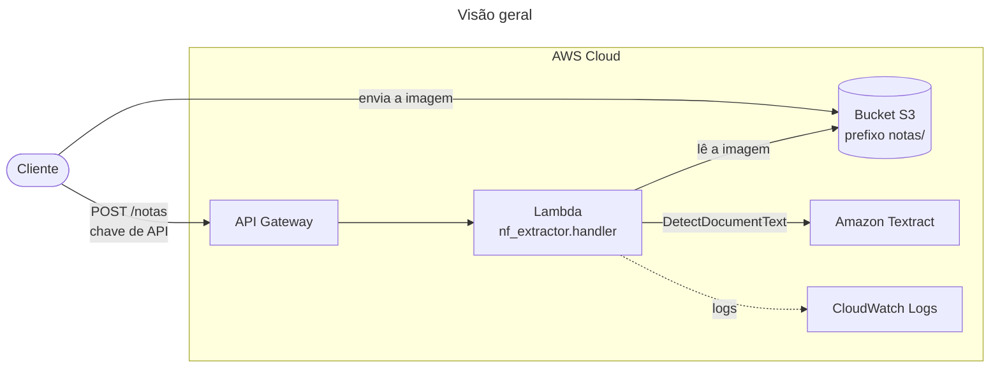
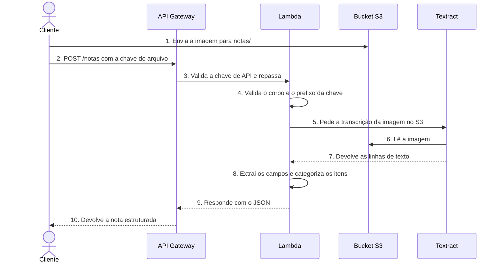

# API de Extração de Notas Fiscais

API serverless que recebe a imagem de uma nota fiscal, transcreve o texto com o Amazon Textract e devolve em JSON o CNPJ, a chave de acesso, a data, o valor total e os itens, cada um já com uma categoria (alimentos, limpeza, higiene, farmácia e outras).

> Inspirado em um projeto em equipe que desenvolvi durante o programa da Compass UOL. Esta é uma implementação independente, escrita do zero.

## Funcionalidades

- Transcrição de imagens de notas fiscais com o Amazon Textract
- Extração de CNPJ (com validação dos dígitos verificadores), chave de acesso de 44 dígitos, data de emissão, valor total e itens
- Categorização dos itens por palavras-chave, com tokenização e stemming do NLTK
- Gancho opcional para refinar com um LLM os itens que as regras não classificaram
- Handler pronto para AWS Lambda com API Gateway, e um CLI para rodar tudo localmente, sem AWS
- Template AWS SAM com bucket privado, chave de API e limite de requisições
- 64 testes automatizados, sem depender da AWS

## Tecnologias

Python 3.12, AWS Lambda, API Gateway, Amazon S3, Amazon Textract, CloudWatch, NLTK, boto3, pytest e AWS SAM.

## Diagramas

### Visão geral



Dentro da função, o texto passa por três etapas:

| Módulo | Responsabilidade |
| --- | --- |
| `transcricao.py` | Chama o Textract e devolve as linhas de texto |
| `parser.py` | Extrai CNPJ, chave, data, total e itens das linhas |
| `categorizador.py` | Classifica cada item com tokenização e stemming (NLTK) |

### Fluxo de uma requisição



## Como rodar localmente

Requer Python 3.10 ou superior. Não precisa de conta AWS para usar o CLI com texto.

```bash
git clone https://github.com/Jotavsts/API-extracao-notas-fiscais.git
cd API-extracao-notas-fiscais
python -m venv .venv
source .venv/bin/activate      # no Windows: .venv\Scripts\activate
pip install -r requirements-dev.txt

# roda os testes
pytest

# extrai uma nota a partir de um texto já transcrito
PYTHONPATH=src python -m nf_extractor --texto exemplos/cupom_exemplo.txt
```

Para transcrever uma imagem de verdade (usa o Textract e **gera custo** depois do nível gratuito), configure suas credenciais AWS e rode:

```bash
PYTHONPATH=src python -m nf_extractor --imagem minha_nota.jpg
```

## Formato esperado das linhas

O parser lê os itens no formato abaixo, comum em cupons fiscais (NFC-e):

```
001 7891000100103 LEITE INTEGRAL 1L 2 UN x 4,50 9,00
```

Número do item e código de barras são opcionais. Cupons com outro layout podem exigir ajustes em `PADRAO_ITEM`, em `parser.py`.

## API

`POST /notas`, com o cabeçalho `x-api-key` e **um** dos campos abaixo:

```json
{ "chave": "notas/cupom-2026-10-28.jpg" }
```

```json
{ "imagem_base64": "..." }
```

Resposta (veja `exemplos/saida_exemplo.json`):

```json
{
  "cnpj": "11.222.333/0001-81",
  "cnpj_valido": true,
  "chave_acesso": "35261011222333000181650010000001231000001234",
  "data_emissao": "2026-10-28",
  "valor_total": 58.67,
  "itens": [
    {
      "descricao": "LEITE INTEGRAL 1L",
      "quantidade": 2.0,
      "valor_unitario": 4.5,
      "valor_total": 9.0,
      "categoria": "alimentos"
    }
  ]
}
```

| Status | Quando |
| --- | --- |
| 200 | Nota processada. Se a imagem não tem texto, a resposta traz o campo `aviso` |
| 400 | Corpo inválido, campos ausentes ou chave fora do prefixo permitido |
| 413 | Imagem maior que 10 MB |
| 502 | O Textract falhou |
| 500 | Erro interno ou de configuração, sem detalhes na resposta |

## Segurança

- O **bucket não vem na requisição**: é lido da variável `BUCKET_NOTAS`. A chave do arquivo precisa começar com `notas/` e não pode conter `..`. Assim, quem chama a API não consegue mandar a função ler outro bucket.
- A função só tem permissão de `s3:GetObject` no prefixo `notas/` e de `textract:DetectDocumentText`.
- A API exige chave de API e tem limite de 5 requisições por segundo.
- O bucket é privado, criptografado, bloqueia acesso público e apaga as imagens depois de 30 dias.
- Os logs do CloudWatch são mantidos por 14 dias, e erros internos não vazam detalhes na resposta.
- Notas fiscais têm dados pessoais. Use apenas imagens suas ou fictícias.

## Deploy na AWS (SAM)

Requer a [AWS SAM CLI](https://docs.aws.amazon.com/serverless-application-model/latest/developerguide/install-sam-cli.html) e credenciais configuradas.

```bash
sam build
sam deploy --guided
```

Ao final, o SAM mostra a URL do endpoint e o nome do bucket. Envie uma imagem para a pasta `notas/` do bucket e chame a API:

```bash
curl -X POST "$URL_DA_API" \
  -H "x-api-key: $SUA_CHAVE" \
  -H "Content-Type: application/json" \
  -d @exemplos/requisicao_exemplo.json
```

Antes de subir, crie um alerta no **AWS Budgets**, e depois de testar rode `sam delete` para remover tudo.

**Estado dos testes:** o template foi validado com `cfn-lint`, e a lógica de extração, o handler e o CLI têm testes automatizados com o Textract simulado. O deploy e a chamada real ao Textract **não foram testados** em uma conta AWS.

## Estrutura

```
.
├── src/
│   ├── nf_extractor/
│   │   ├── modelos.py        # NotaFiscal, Item e validação de CNPJ
│   │   ├── parser.py         # extração dos campos e dos itens
│   │   ├── categorizador.py  # categorização com NLTK
│   │   ├── transcricao.py    # integração com o Textract
│   │   ├── handler.py        # entrada da função Lambda
│   │   └── cli.py            # execução local
│   └── requirements.txt      # dependências empacotadas na Lambda
├── tests/                    # testes automatizados
├── exemplos/                 # nota fictícia, requisição e resposta de exemplo
├── template.yaml             # infraestrutura (AWS SAM)
└── requirements*.txt
```

## Licença

MIT. Veja o arquivo [LICENSE](LICENSE).
